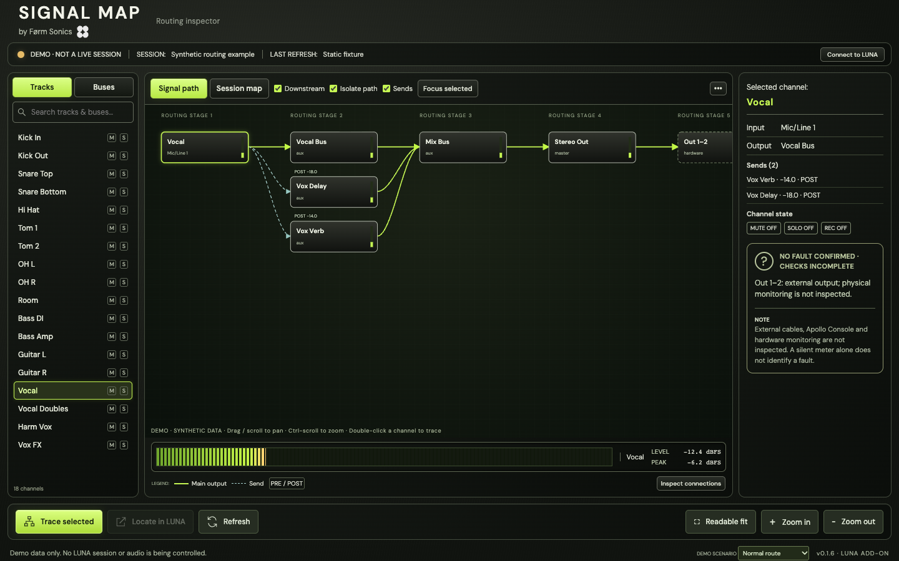

# Signal Map
### by Førm Sonics

Read-only LUNA routing inspector with signal-path diagrams and evidence-based diagnostics.

**Status: release candidate under final verification.** Current version: **0.1.6**.
Not yet submitted to UA Universe. Not an AU/VST plugin. Targets LUNA 3.1.2 or compatible newer hosts; broader compatibility is not verified.

## Preview



*Labeled synthetic demo, not a live audio session. [Session map preview](docs/images/demo-map.png).*

## Getting started
See [User guide](docs/USER-GUIDE.md) for installation, workflows, limitations and backups.
There is no public release attached yet. Native acceptance and update-persistence checks remain release gates.

## Repository layout
- `app/` — add-on runtime, manifest, branding and third-party notices
- `tests/` — automated logic and SDK mock checks
- `scripts/` — pinned SDK setup and packaging
- `docs/` — user guide, release checklist and licensing notes
- `dist/` — generated installers (ignored)

## Development
Use Node.js 22+ and Git. Read the SDK terms before running setup.

```sh
npm run setup
npm test
npm run pack
npm run serve
```

Setup downloads the official SDK at commit `62b8d383a1a33502d6dd170c92c359dcc0014f90` into ignored `.sdk/`.
The pinned SDK setup removes dependency on a sibling checkout. Public source visibility does not grant modification or redistribution rights; consult LICENSE.txt before using this source beyond the permitted scope.
Packaging includes `app/` only; tests, development SDK and repository docs are not shipped.
Tests use mock engines and do not prove native LUNA behavior.

## Release and support
- [Release checklist](docs/RELEASE-CHECKLIST.md)
- [Changelog](CHANGELOG.md)
- [Verification evidence](docs/VERIFICATION.md)
- [Data handling](docs/PRIVACY.md)
- [Third-party notices and licensing](docs/LICENSING.md)
- Use repository issues for development reports; do not attach private sessions, client material or credentials.
- Support: FORMsonics@proton.me
- Freeware, copyright retained; **not open source**. See [LICENSE.txt](LICENSE.txt).

## Suite
[Phase Lab](https://github.com/formsonics/phase-lab) · [Signal Map](https://github.com/formsonics/signal-map) · [Lyric Prompter](https://github.com/formsonics/lyric-prompter) · [Recall Atlas](https://github.com/formsonics/recall-atlas) · [Revision Desk](https://github.com/formsonics/revision-desk) · [Take Notes](https://github.com/formsonics/take-notes)
